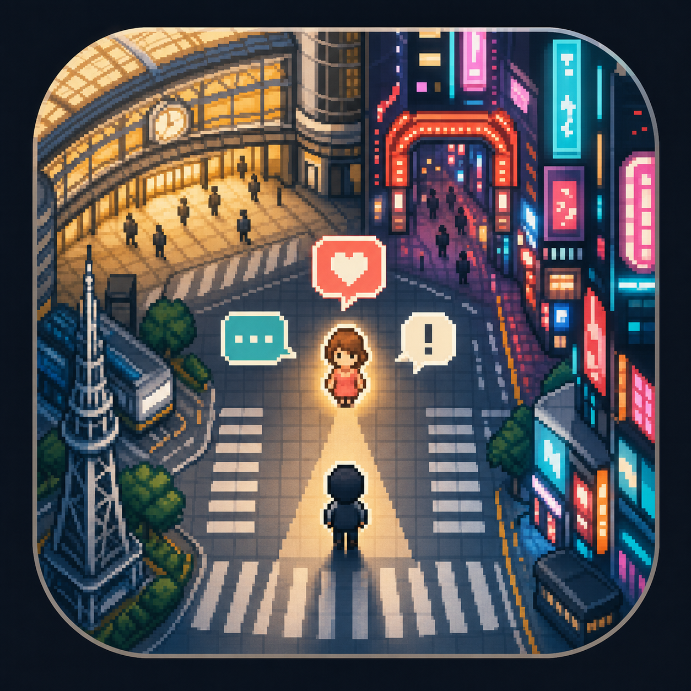
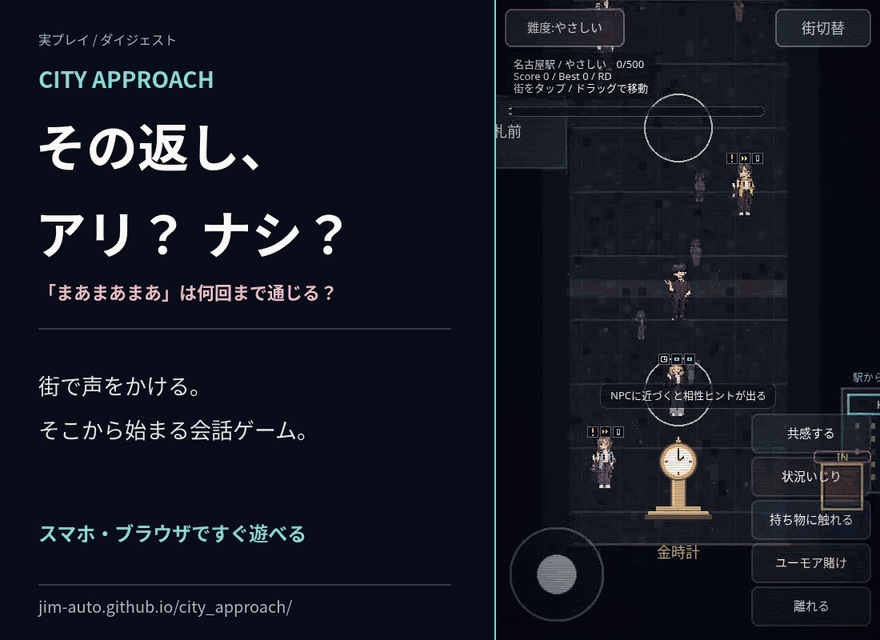

# city-approach

街で相手のサインを読み、声をかけるか離れるかを判断するPhaser 3製の2Dゲームです。ブラウザだけで動き、GitHub Pagesにそのまま置けます。



## Demo

[公開版で遊ぶ](https://jim-auto.github.io/city_approach/)



[WebM版を見る](./assets/demo.webm)

## GitHub About

- Description: 街で相手のサインを読み、距離感と会話の文脈を判断するブラウザ2Dゲーム
- Website: GitHub Pagesの公開URL
- Topics: `phaser`, `browser-game`, `javascript`, `pixel-art`, `github-pages`, `city-game`

## ゲーム内容

- 名古屋駅と歌舞伎町を切り替えながら、NPCの行動サインを観察する。
- 声かけは「共感する」「状況いじり」「持ち物に触れる」「ユーモア賭け」から選択する。
- NPCの状態、余裕、警戒、きっかけを見て、有効なオープナーを選ぶ。
- 防御サインが強い相手には「離れる」が正解になる。
- 会話では相手の不安に合う返答を4枚のフリップから選ぶ。時間・友達・予算・警戒など8テーマを出題する。
- 4つの不安のうち3つ以上に応え、タイプごとの必要好感度（60〜78）を満たし、違和感60未満で最後の誘いが合うと同行へ進む。
- スマホ向けに縦横の画面へ対応し、会話の選択肢はブラウザ標準ボタンでタップを受け取る。
- 会話が成立すると横スクロールの同行ステージへ。二人で右へ歩き、ホテル到着でゴール（+100点）。
- 左右ボタン長押し・矢印/A/Dキー・画面タップで移動。遠景がゆっくり流れ、ホテルまでの距離と進捗を表示。
- 同行中は4回、相手から「どこ行くんですか？」などの質問が来る。「行き先を話す」「まあまあまあ」「やめる？と聞く」で応対する。
- 「まあまあまあ」を連続すると不信感が20→55→100と上がり、3回連続で同行終了。説明すると不信感が25下がり、連続流し回数もリセット。
- ホテル前の行き先確認は流しても解決しない。相手が納得してからホテル到着になる。同行終了では到着ボーナスを得られず、連続記録もリセット。
- ホテルが各同行ステージのゴール。累計500点ではCITY CLEARも獲得でき、Bestとランク更新を狙って続行できる。

## ローカル起動

```bash
python3 -m http.server 8000 --bind 127.0.0.1
```

ブラウザで `http://127.0.0.1:8000/` を開きます。

## 自動テスト（Playwright）

Node.js 20以上で実行します。テスト専用の依存関係で、ゲームの配信にビルドは不要です。

```bash
npm ci
npx playwright install --with-deps chromium webkit
npm test
```

テスト用HTTPサーバーは自動起動します。既存サーバーを使う場合は `SMOKE_URL` を指定できます。
`npm run test:smoke` で既存機能の回帰テスト、`npm run test:mobile` でスマホ向けテストのみ実行できます。

スマホ向けテストはChromiumとWebKitで、320×568、360×640、390×844、412×915、568×320、844×390を検証します。
街→会話→同行→ホテル→街への復帰をタッチで操作し、44px以上のボタン、文字のはみ出し・重なり、画面回転、ノッチ相当の余白をチェックします。
Chromiumではドラッグ、複数の指、タッチキャンセルも検証し、390px幅では全ルートを右ボタンの長押しで歩きます。
その他の到着テストはホテル近くの位置を使います。声かけのみ成功率を固定し、会話の選択とステージの操作は実際のタッチ入力です。
同行会話は4回の応対と行き先確認による成功、3回連続のごまかしによる同行終了と無報酬・街への復帰もタッチで検証します。
結果とスクリーンショットは `test-results/mobile/` に保存されます。実機ではなくブラウザエミュレーションです。

## スマホ対応

- 縦向き・横向きでタイトル、街、会話、同行、ゴール画面を配置し直す。
- 動的なブラウザバーとノッチ／ホームバーの余白に追従する。
- 指を離す、操作がキャンセルされる、別タブに移る、回転する際に移動入力を解除する。
- 会話では文字を読みやすく折り返し、返答の制限時間を5秒に設定する。
- 同行中の遠景はカメラが動く時だけ描き直す。

## 調査メモとゲーム反映

### 名古屋駅

- 中央通路が桜通口と太閤通口を結び、金時計・銀時計が待ち合わせ地点になっている。ゲームでは横長の中央コンコース、両端の時計、改札前の停止ポイントとして反映。
- 金時計周辺は待ち合わせ人数が多く、改札前・時計前で立ち止まる行動が起きやすい。ゲームでは「待ち合わせ系」「スマホ」「立ち止まり」のNPCを出し、成功率を少し上げる一方、人混みの距離感も判定する。
- 朝夕ラッシュは交通量が増えるため、昼は比較的判断しやすく、夕方寄りの混雑は失敗要因になる。ゲームでは名古屋駅を直線的な人流、NPCの規則的な移動で表現。

### 歌舞伎町

- 国内外から人が集まる繁華街で、夜はネオン、飲食・娯楽施設、観光客で密度が高い。ゲームでは暗い路面、ネオン看板、ランダムな群衆移動、ノイズペナルティで反映。
- 客引き・路上勧誘は新宿区の条例や警察の注意喚起対象。ゲームでは「夜の警戒」「声かけが多い」という会話行にし、違和感ゲージが上がりやすい設計にした。
- 単独よりグループ行動の防御力が高く、流れを止める声かけは失敗しやすい。ゲームでは「友達同伴系」に大きめの成功率マイナスを設定。

## キャラクター抽象化

```js
{
  type: "忙しい系",
  traits: ["スマホ", "歩くの速い", "外界遮断"],
  difficulty: "高",
  effective_actions: ["短く要点", "邪魔しない"],
  bad_actions: ["長話", "距離詰め"]
}
{
  type: "待ち合わせ系",
  traits: ["立ち止まり", "スマホ", "待ち合わせ"],
  difficulty: "低",
  effective_actions: ["軽く", "状況ツッコミ"],
  bad_actions: ["長話", "距離詰め"]
}
{
  type: "友達同伴系",
  traits: ["友達といる", "周囲を見る"],
  difficulty: "高",
  effective_actions: ["グループの邪魔をしない", "短く"],
  bad_actions: ["一人だけに強く行く", "距離詰め"]
}
{
  type: "目線あり系",
  traits: ["目が合う", "歩くの遅い"],
  difficulty: "中",
  effective_actions: ["軽く", "自然な提案"],
  bad_actions: ["強すぎる直球"]
}
{
  type: "イヤホン系",
  traits: ["イヤホン", "外界遮断", "歩くの速い"],
  difficulty: "高",
  effective_actions: ["邪魔しない"],
  bad_actions: ["急に割り込む", "長話"]
}
```

## 実装方針

- NPCは抽象化したtraitsをランダム合成し、traitsごとに成功率補正を加える。
- 名古屋駅は直線移動と停止ポイント、歌舞伎町はランダム移動と高密度の環境ノイズで差を出す。
- 16x16/32x32系のトップダウンドットを参考に、完全オリジナルの32x32 PNGを8色以内で作成。
- 実在人物の再現、特定の文化や個人への偏見を助長する表現は入れない。見た目ではなく「行動サイン」をゲーム判定に使う。

## 参考にした情報

- Nagoya Station: https://www.nagoyastation.com/nagoya-station-map-finding-your-way/
- 名古屋駅の待ち合わせスポット: https://sotokoto-online.jp/life/10262
- 新宿区 歌舞伎町地区のまちづくり: https://www.city.shinjuku.lg.jp/kusei/keikan01_001083.html
- 新宿区 客引き行為等の防止: https://www.city.shinjuku.lg.jp/anzen/kikikanri01_000001_00057.html
- 警視庁 Tips for Safe Drinking in Shinjuku: https://www.keishicho.metro.tokyo.lg.jp/about_mpd/shokai/ichiran/kankatsu/shinjuku/about_ps/safe_drinking.files/English.pdf
- JNTO Kabukicho: https://www.japan.travel/en/spot/1668/
- Phaser CDN利用: https://docs.phaser.io/phaser/getting-started/installation
- Pixel art参考: https://coldrice.itch.io/top-down-pixel-art-sprites-16x16
- Pixel tile参考: https://philtacular.itch.io/top-down-kingdom

## キャラクター画像 v4

主人公はv3画像の右下の男性をベースに、黒のマッシュヘアとTシャツ姿に変更（ジャケットなし）。女性NPCは20〜24歳の美容・デザイン・音楽・服飾の専門学生、大学生、地雷系、カフェバイトなど、私服・髪型・持ち物で描き分けた。近くの相手の表示にタイプ名も表示する。
主人公と10種類のNPCは、透過PNGの共通アトラス `assets/ai/characters-v4.png` を使用。
4列×3行のうち先頭11セルを `characters.js` で読み込み、会話用ポートレートと48pxの移動用スプライトを生成する。
生成方法・最終プロンプトは `assets/ai/characters-v4-prompt.txt` を参照。旧画像は比較用として残している。

## ホテルまでの街並み

`scenery.js` でコードから描画。名駅は夕焼けと落ち着いた店先、歌舞伎町は月夜・ネオン・濡れた舗道の反射で描き分ける。二層の遠景が異なる速度で流れ、商店街、街路樹のある広場、ホテル前へと景色が変わる。ホテルにはガラスの入口、庇、植栽、暖色の照明を追加。乱数は座標から固定して、歩行やリサイズ時に景色がちらつかないようにした。

## 不安に返すフリップ会話

会話は4つの不安と最後の誘いの全5ラウンド。警戒・時間・友達・予算・行き先・距離感・疲れ・断りづらさ・暇・髪と服・相手に合うノリの11テーマから、相手の状況に応じて出題する。4枚の具体的な返答を読み、相手の不安に合うフリップを選ぶ。正解の場所はシャッフルされ、正誤ごとに相手から理由のあるリアクションが返る。3テーマ以上で安心を得て、タイプごとの必要好感度（60〜78）を満たし、違和感60未満で最後の提案が合うと同行へ進む。各ラウンドは属性に応じて12〜16秒、スマホのフリップは2列。台詞と選択肢は `conversation-flips.js`、進行と表示は `scenes/TalkScene.js`。

## 女の子の色違い（40種類）

元の10人にパステル・ストリート・シックの各10人を追加し、合計40種類。肌に一括で色を重ねず、内蔵の画像生成ツールで髪と服の配色を描き分けた。新しい透過アトラスは `assets/ai/characters-colors-pastel.png`、`characters-colors-street.png`、`characters-colors-chic.png`。元の4列×3行のセル配置を引き継ぎ、生成プロンプトは `assets/ai/characters-colors-prompts.txt` に保存。

`characters.js` の `NPC_COLORWAYS` で配色を管理し、各配色に移動用2フレームと会話用の高解像度立ち絵を登録する。街では4配色が偏らないように出現し、会話からホテルまで同じ見た目を維持する。主人公は元の黒マッシュ・Tシャツ姿を使う。

`npm run test:colorways` でChromium・WebKitそれぞれの全40種の画像、透過、配色差、歩行アニメーション、街の配色分布、会話と同行の姿の一致を確認する。一覧画像は `test-results/colorways/all-40.png` に出力する。

## 会話のタップ入力

会話フリップと同行会話の返答は、描画位置に重ねたHTMLの標準ボタンで入力を受け取る。見た目はPhaserのカード描画を使い、クリック、タップ、キーボード操作をブラウザに任せる。ボタンはキャンバス用のタッチ抑制の対象外に配置し、返答処理中は無効化、次の質問で有効化する。画面回転に追従し、シーンを離れると削除する。実装は `native-buttons.js`。

`npm run test:taps` で縦横4サイズ×Chromium／WebKit、全4カードの中央と四隅（計160箇所）を確認する。実際の会話進行、キーボード、シーン切り替え後のボタン削除も検証する。Chromiumでは指が少し動くタップも確認する。


## ラブホテルと属性の相性

ゴールはラブホテル。同行前のフリップと歩行中の会話で行き先を伝え、入口でも入るかどうか確認する。ラウンジへの誘いにはしない。外観にピンクのハートと `LOVE HOTEL` の看板を追加。

相手は全員20〜24歳の架空の成人キャラクター。職業・見た目・現在の状況を組み合わせて7タイプを判定し、初期好感度、警戒、選択肢ごとの加点、誤答時の違和感、同行に必要な好感度を変える。同じ軽口でも「暇なプリン髪大学生」は+34、急いでいる相手は+4となり、後者には短い返答の方が合う。専門学生は服や髪の話、友達といる相手は予定への配慮、慎重派は具体的な説明が得意な返しになる。相性と獲得好感度はその場で表示する。

専用のプリン髪大学生（21歳）は、黒い根元が伸びた金髪とゆるい私服で描き分け、各マップに1人出現する。既存40種類に加えた41番目の見た目として `assets/ai/character-prin-student.png` に保存。内蔵画像生成ツールを使用し、プロンプトは `assets/ai/character-prin-student-prompt.txt`。

属性ルールは `encounter-rules.js`、会話の出題は `conversation-flips.js`。`npm run test:encounters` で属性別の効果差と、7タイプ×縦横画面×Chromium／WebKitの操作を検証する。

## 初期難易度とゴール演出

初回起動の難易度は「やさしい」。自分で変更した難易度は次回にも引き継ぐ。ラブホテル到着時は大きな「ゴール！」の文字が弾んで現れ、紙吹雪、光、効果音でゴールを祝う。到着ボーナスは従来どおり+100で、一度だけ加算。端末で動きを減らす設定を使っている場合は、文字をすぐ表示し、点滅や紙吹雪は省く。

`npm run test:goal` で初期難易度、保存した設定、縦横画面の演出、得点の重複防止、再挑戦後の失敗で祝福が残らないことを確認する。

## ゴールの記念CG

ラブホテル到着時は、ピンクのネオンと暖かな入口、濡れた舗道を描いた専用背景に、主人公と実際に同行した女の子の高解像度立ち絵を重ねた記念CGを表示する。41種類の姿・色違いを引き継ぎ、縦画面は絵を大きく、横画面は絵と結果を左右に配置。回転時にも構図を調整する。背景は内蔵画像生成ツールで作成し、`assets/ai/goal-cg-backdrop.png`、最終プロンプトは `assets/ai/goal-cg-backdrop-prompt.txt` に保存。

`npm run test:goal` はCGの実際の描画ピクセル、同行相手・配色の一致、画面回転、動きを減らす設定、再挑戦時の失敗画面への持ち越しも検証する。

## 相手ごとのホテル内コスプレCG

ゴール後は相手の姿に応じて、ホテル内でコスプレした記念CGを表示する。メイド、マジシャン、ゴシックプリンセス、猫耳パーカー、ネオンアイドル、浴衣、魔法使い、クラシカルドレス、パティシエ、スペースパイロット、ブルーアリスの11衣装。従来の4配色×10人とプリン髪大学生を引き継いだ計41種類で、全員20〜24歳の成人キャラクター。衣装ごとに本人のひとことも変わる。

室内はローズ系とネオン系の2種類。`goal-costumes.js` で街のキャラと配色から衣装、台詞、部屋を決め、同行時に必要な配色の画像と部屋だけを読み込む。人物の透過部分を測って二人を配置し、広いスカートや帽子が切れないようにする。衣装はゴール画面でのみ使い、街と会話中は私服のまま。得点と同行中の行き先確認は従来どおり。

内蔵画像生成ツールで制作した画像は `assets/ai/costumes-{original,pastel,street,chic,prin}.png` と `assets/ai/room-{rose,neon}.png`。最終プロンプトと参照画像は `assets/ai/cosplay-prompts.json` に保存。

`npm run test:costumes` はChromium／WebKitで全41種類のCG、11衣装、2部屋、透過、絵の重複防止、相手と配色の一致、人物のはみ出し防止、台詞と得点を確認する。衣装一覧と各衣装のゴール画面は `test-results/costumes/` に出力。

## かんたんジャンプとフィーバー

同行ステージに、二人で跳んでハートを集めるアクションを追加。左右の移動に加えて、中央の「ジャンプ」を長押しすると連続ジャンプする。キーボードはSpace／↑／Wでジャンプ、矢印／A・Dで移動。スマホでは右移動とジャンプを二本指で同時に長押しできる。

8か所の水たまりと24個のハートがあり、ジャンプで上のハートも取れる。1個+5点、3個ごとに追加+10点と3.5秒のフィーバー（移動速度1.35倍）。地面のハートはジャンプ中も拾え、コンボは時間切れにならない。歩くだけでも水たまりは小ジャンプで自動回避し、ぶつかった場合も0.45秒だけ減速する。アクションで得点・不信感を失うことはなく、集めた数にかかわらずホテルへ到着できる。到着ボーナス+100は別に一度だけ加算。

会話中はアクション・移動・フィーバーの残り時間を止め、回転・タッチ中断・フォーカスが外れた時はジャンプ長押しも解除。動きを減らす設定ではフィーバーの残像を省く。実装は `walk-action.js`。

`npm run test:action` はChromiumの実際の二本指操作、WebKitのタップとキーボード長押しで全ルートを確認する。ハート・フィーバー・得点、会話中の停止、操作なしの自動回避、軽い衝突からの復帰、画面回転と入力解除も検証し、画面例は `test-results/action/` に出力する。
